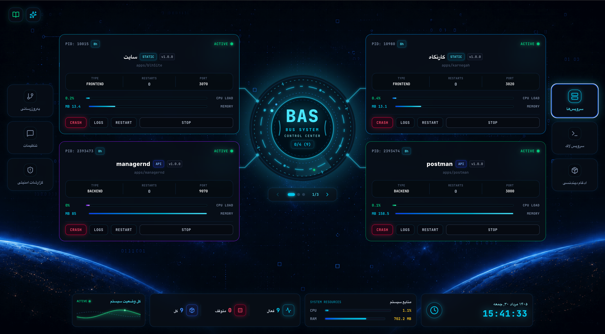

<div dir="rtl">

# 🚀 سامانه BAS (ارکستراتور بومی Node.js)

[](https://github.com/mohammadnjt/bas)

<!-- عکس پیش‌نمایش داشبورد -->
<div align="center">
  
</div>

**BAS** یک سیستم مدیریت پروسه و ارکستراتور مدرن، هوشمند و بومی برای برنامه‌های مبتنی بر Node.js (بک‌اند و فرانت‌اند) است. این سامانه به عنوان یک جایگزین پیشرفته برای ابزارهایی نظیر `PM2` طراحی شده و با داشتن رابط کاربری گرافیکی قدرتمند، هوش مصنوعی یکپارچه و لایه‌های امنیتی سخت‌گیرانه، مدیریت سرورها و اپلیکیشن‌ها را بسیار ساده و امن می‌کند.

---

## ✨ ویژگی‌های کلیدی

### ۱. مدیریت هوشمند پروسه‌ها (Process Management)
- **پایش زنده منابع:** نمایش لحظه‌ای میزان مصرف CPU و حافظه RAM کل سیستم و هر برنامه به صورت مجزا.
- **Auto-Restart Engine:** شناسایی خودکار کرش‌ها و راه‌اندازی مجدد برنامه‌ها با تاخیر و سقف مشخص.
- **نمایش زنده لاگ‌ها (Live Logs):** دسترسی بلادرنگ به خروجی کنسول اپلیکیشن‌ها همراه با قابلیت جستجو، فیلتر و Auto-scroll.

### ۲. امنیت پیشرفته و دفاع فعال (Advanced Security)
- **احراز هویت:** ورود با نام کاربری و رمز عبور و نشست امن (کوکی HttpOnly)؛ برای اسکریپت‌ها کلید API از طریق هدر.
- **لیست سفید آی‌پی‌ها (IP Whitelisting):** محدود کردن دسترسی پنل تنها به IPهای خاص تعریف شده در `.env`.
- **محافظت در برابر Brute-force:** مسدودسازی اتوماتیک ۲۴ ساعته IP هکرها پس از ۵ تلاش ناموفق برای ورود.
- **هدرهای امنیتی و Rate Limiting:** استفاده از پکیج `helmet` و محدودکننده درخواست (۲۰۰ درخواست در ۱۵ دقیقه) برای دفع حملات DoS و XSS.
- **داشبورد امنیتی:** مشاهده زنده لاگ‌های ورود موفق/ناموفق و مدیریت لیست سیاه (Banned IPs) در داخل پنل.

### ۳. هوش مصنوعی عیب‌یاب (AI Diagnostics)
- مجهز به دستیار هوشمند مبتنی بر **Google Gemini API**.
- قابلیت بررسی خودکار لاگ‌های کرش شده، ریشه‌یابی خطاها (Root Cause Analysis) و ارائه راهکارهای عملیاتی برای رفع باگ.

### ۴. سیستم هشدار پیامکی (SMS Alerts)
- یکپارچه با درگاه پیامکی (BLH SMS Gateway) از طریق پترن OTP.
- **ارسال پیامک آنی در دو حالت:**
  1. هنگام کرش کردن و متوقف شدن اپلیکیشن‌ها.
  2. هنگام تشخیص حمله امنیتی و بن شدن آی‌پی هکر.

### ۵. مدیریت گروهی و اتوماسیون (Automation Tools)
- **به‌روزرسانی گروهی گیت (Bulk Git Update):** گرفتن `git pull` همزمان روی ده‌ها مخزن با استفاده از جستجوی کلمه کلیدی.
- **ادغام خودکار وابستگی‌ها (Dependency Merger):** اسکن هوشمند تمام پروژه‌های ساب‌فولدر، استخراج `package.json` ها، ادغام پکیج‌ها و نصب یکپارچه برای کاهش حجم اشغالی (مناسب معماری مونو-ریپو).

---

## 🛠 تکنولوژی‌های استفاده شده

- **فرانت‌اند:** React 18, TypeScript, Tailwind CSS, Framer Motion, Lucide Icons
- **بک‌اند:** Node.js, Express.js, Child_Process API, Vite Middleware
- **امنیت:** Helmet, Express-Rate-Limit
- **هوش مصنوعی:** `@google/genai` (Gemini)

---

## 📦 راهنمای نصب و راه‌اندازی

### پیش‌نیازها
- نصب بودن Node.js (نسخه ۱۸ به بالا)
- سیستم‌عامل لینوکس/مک/ویندوز

### ۱. دریافت و نصب
ابتدا پروژه را کلون کرده و وابستگی‌ها را نصب کنید:
```bash
git clone https://github.com/mohammadnjt/bas.git
cd bas
npm install
```

### ۲. تنظیمات محیطی (.env)
یک فایل `.env` در ریشه پروژه بسازید (می‌توانید از فایل `.env.example` الگو بگیرید):

```env
# نام کاربری و رمز عبور ورود به پنل. اگر رمز تنظیم نشود، در اولین اجرا یک رمز تصادفی
# ساخته شده و در همین فایل (.env) ذخیره می‌شود.
ADMIN_USERNAME=admin
ADMIN_PASSWORD=a_long_random_password

# (اختیاری) توکن هوش مصنوعی گوگل برای سیستم عیب‌یاب
GEMINI_API_KEY=your_gemini_api_key

# آدرس پایه سرویس پیامک و توکن آن برای دریافت هشدارهای کرش و امنیت
SMS_API_URL=https://your-sms-provider.com/api/send
SMS_APIKEY_BAS=your_sms_gateway_token

# (اختیاری) آدرس ریدایرکت برای کاربران غیرمجاز (اگر تنظیم شود، کاربران بدون دسترسی به این آدرس منتقل می‌شوند)
UNAUTHORIZED_REDIRECT_URL=https://your.domain.ir

# لیست سفید آی‌پی‌ها جهت دسترسی به پنل (با کاما جدا شوند). خالی گذاشتن = دسترسی آزاد
ALLOWED_IPS=192.168.1.100,10.0.0.5

# (اختیاری) پروکسی‌هایی که آدرس واقعی کاربر را در X-Forwarded-For می‌فرستند.
# پیش‌فرض loopback است (مثلاً nginx روی همین سرور). اگر پشت پروکسی یا لودبالانسر دیگری هستید،
# آدرس آن را بنویسید (مثلاً 10.0.0.2). هرگز true نگذارید مگر اینکه پنل فقط از طریق پروکسی در دسترس باشد.
BAS_TRUST_PROXY=loopback

# (اختیاری) آدرسی که پنل روی آن گوش می‌دهد. با 127.0.0.1 پنل فقط از طریق پروکسی محلی (nginx) در دسترس است.
BAS_HOST=0.0.0.0

# (اختیاری) با false وابستگی‌های اپ‌ها هنگام اجرا به‌صورت خودکار در پوشه BAS نصب نمی‌شوند.
BAS_AUTO_SYNC_DEPENDENCIES=true
```

### ۳. بیلد و اجرای سیستم در محیط Production
از آنجایی که سیستم نیازمند مدیریت فایل‌ها و اجرای دستورات است، بیلد نهایی از طریق `esbuild` ساخته می‌شود:

```bash
# کامپایل فرانت‌اند و بک‌اند به صورت یکپارچه
npm run build

# اجرای سیستم
npm run start
```
*سامانه به صورت پیش‌فرض بر روی پورت `3000` اجرا خواهد شد. نسخه بیلد شده همیشه در حالت production اجرا می‌شود؛ `npm run dev` فقط برای توسعه است.*

---

## 📂 نحوه تعریف اپلیکیشن‌ها

سیستم BAS اپلیکیشن‌های شما را از روی پوشه `apps` به صورت خودکار شناسایی می‌کند. برای پیکربندی هر اپلیکیشن، کافیست یک فایل به نام `bas.config.json` در ریشه پوشه همان اپلیکیشن ایجاد کنید. 

> سیستم منحصراً برای دریافت پیکربندی از فایل `bas.config.json` استفاده می‌کند.

### نمونه فایل `bas.config.json`
این فایل تمامی مشخصات اجرایی و گروه‌بندی سرویس شما را تعیین می‌کند:

```json
{
  "name": "foodrond",
  "type": "backend",
  "entry": "server.js",
  "port": 9009,
  "autoStart": true,
  "groups": ["payment", "core"]
}
```

- **`type`**: می‌تواند `backend` یا `frontend` باشد.
- **`entry`**: فایل اجرایی (برای بک‌اند مثل `server.js`) یا مسیر بیلد (برای فرانت‌اند مثل `dist`).
- **`groups`**: (جدید) آرایه‌ای از نام گروه‌ها. با استفاده از این فیلد می‌توانید اپلیکیشن‌های مرتبط را در یک گروه قرار داده و از طریق تب آپدیت گروهی (با وارد کردن نام گروه) تمامی آن‌ها را با یک کلیک بروزرسانی کنید.
- **`id`**: (اختیاری) شناسه یکتای سرویس. در صورت عدم تنظیم، `name` داخل `package.json` استفاده می‌شود؛ اگر چند پوشه `package.json` هم‌نام داشته باشند، نام پوشه به عنوان شناسه در نظر گرفته می‌شود.
- **`gitUrl`**: (اختیاری) آدرس مخزن گیت. اگر پوشه هنوز `.git` نداشته باشد، در اولین بروزرسانی مخزن در همان پوشه ساخته می‌شود و فایل‌های موجود (مثل `bas.config.json` و `.env`) حفظ می‌شوند.
- **`gitBranch`**: (اختیاری) شاخه‌ای که این سرویس از آن منتشر می‌شود. در صورت عدم تنظیم، شاخه فعلی یا شاخه پیش‌فرض مخزن استفاده می‌شود. شاخه وارد شده در پنل بر این مقدار اولویت دارد.

### انتشار یک پروژه برای چند مشتری

برای هر مشتری یک پوشه جدا در `apps/` بسازید (کلون همان مخزن، یا فقط یک `bas.config.json` همراه با `gitUrl`) و در `bas.config.json` هر کدام `name` و `port` مخصوص همان مشتری و یک گروه مشترک قرار دهید:

```json
{ "name": "فروشگاه - مشتری الف", "port": 9101, "groups": ["shop"], "gitUrl": "https://git.example.com/team/shop.git" }
```

با انتخاب گروه `shop` در تب آپدیت گروهی، همه نسخه‌ها بروزرسانی می‌شوند. فایل‌های `bas.config.json` و `.env` هر پوشه و فایل‌های خارج از گیت (مثل آپلودها) در بروزرسانی حفظ می‌شوند.

---

## 🛡️ ورود به پنل

آدرس پنل (مثلاً `http://your-server-ip:3000`) را باز کنید و با `ADMIN_USERNAME` و `ADMIN_PASSWORD` وارد شوید. نشست ورود در یک کوکی HttpOnly ذخیره می‌شود و ۷ روز معتبر است؛ با خروج از حساب، تغییر رمز یا ری‌استارت BAS باطل می‌شود. در صورت تنظیم `UNAUTHORIZED_REDIRECT_URL`، بازدیدکنندگان بدون نشست به آن آدرس منتقل می‌شوند.

برای اسکریپت‌ها می‌توانید مقدار `base64("ADMIN_USERNAME:ADMIN_PASSWORD")` را در هدر `x-api-key` بفرستید. پس از ۵ تلاش ناموفق (ورود یا کلید API)، آی‌پی به مدت ۲۴ ساعت مسدود می‌شود.

### نکات امنیتی استقرار

- پنل را پشت nginx با HTTPS قرار دهید و `BAS_HOST=127.0.0.1` را تنظیم کنید تا رمز و نشست روی شبکه به صورت متن ساده جابه‌جا نشوند.
- BAS را با یک کاربر سیستمی جداگانه (نه root) اجرا کنید.
- همه اپ‌ها با کاربر سیستمی BAS اجرا می‌شوند و به فایل‌های یکدیگر دسترسی دارند. اگر کد مشتری‌ها از منابع غیرقابل‌اعتماد می‌آید، هر مشتری را در یک سرور، کانتینر یا نمونه BAS جداگانه با کاربر سیستمی خودش اجرا کنید.

</div>